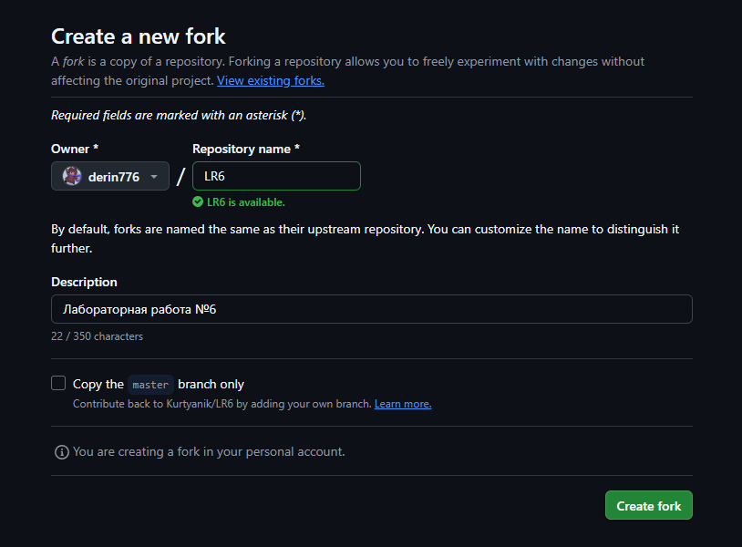
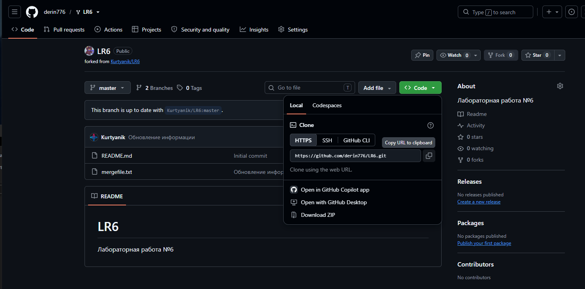
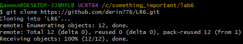
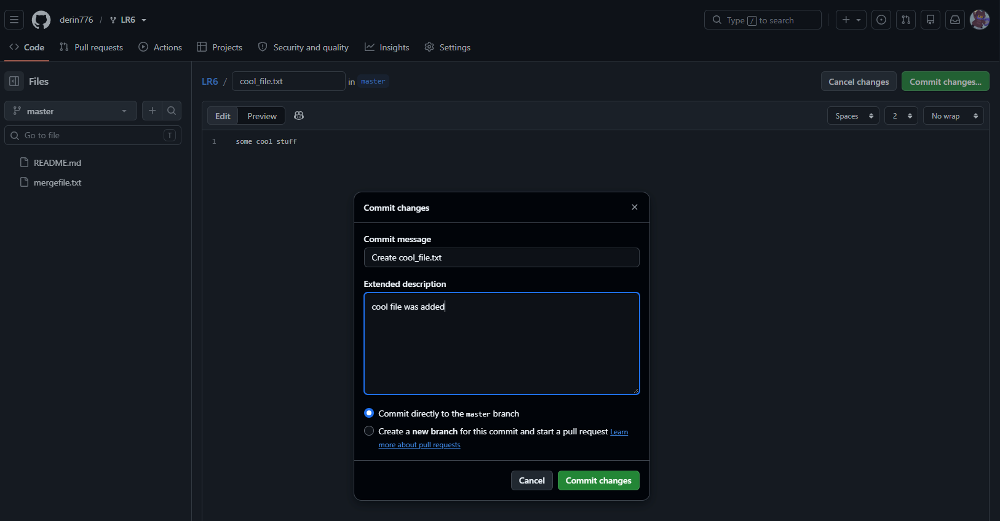
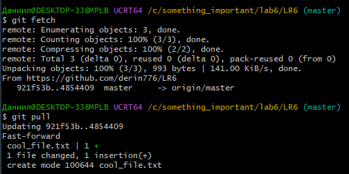
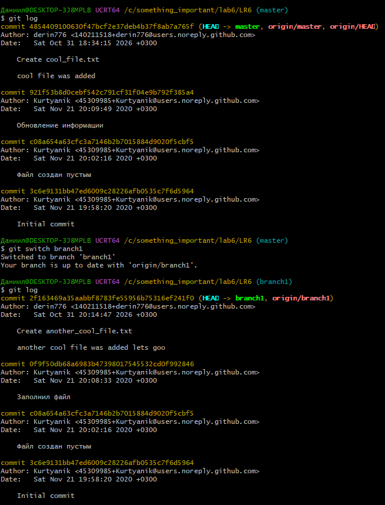
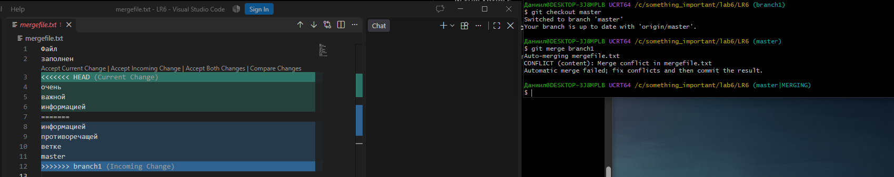
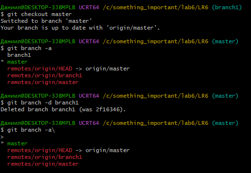
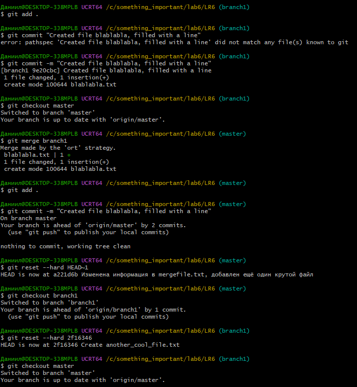
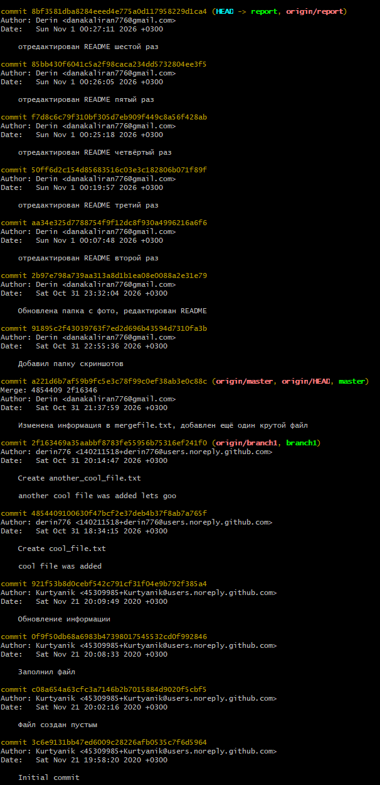

# Отчёт о лабораторной работе №6

## Форк другого проекта
Была сделана копия (fork) [репозитория](https://github.com/Kurtyanik/LR6/) из материалов к лабораторной работе.



После этого был установлен [Git](https://git-scm.com/)

## Клонирование репозитория на компьютер

После установки Git был запущен Git Bash и создан локальный клон форка





## Добавление файла и подтягивание изменений в локальный репозиторий

На сайте форка был создан новый файл



После этого была использована команда git pull для подтягивания изменений в локальный репозиторий



## Получение логов

Последние изменения были просмотрены с помощью команды git log



## Слияние branch1 в ветку master и удаление ветки

Слияние выполнялось из ветки master с помощью команды git merge branch1. Во время слияния произошёл конфликт файла, который был разрешён путём выбора между изменениями. Был выбран вариант "Accept Incoming Change"



После этого ветка branch1 была удалена из локального репозитория, а ветка master была коммитнута и загружена на сервер



## Откат коммита

Был создан новый файл в заново загруженной ветке branch1. После слияния branch1 в master было принято решение откатить коммит. Для этого в ветках master и branch1 была прописана команда git reset --hard HEAD~1. После этого добавленный файл удалился, а изменения откатились.



Далее была создана новая ветка в локальном репозитории report, в которой в файле README.md был написан отчёт.

## Лог команд
```
git clone https://github.com/derin776/LR6.git
git pull
git log
git checkout
git merge branch1
git status
git add .
git commit -m
git push origin master
git reset --hard HEAD~1
```

## История операций

